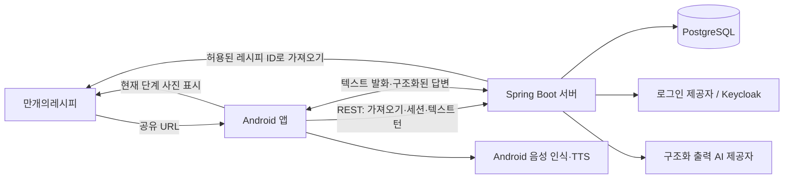

# 한술 개발 계획

작성: 2026-09-28 · 갱신: 2026-10-12 · 상태: 요리 화면·수동 진행·상황별 안내 확장 중

현재 구현된 축은 Android 공유 수신/로그인/레시피 미리보기, 서버의 범용 만개의레시피 가져오기·인분 기준값 계산·인증, 그리고 원문 근거를 검증하는 요리 세션/텍스트 턴 API다. 서버에는 화면 위치와 실제 완료/건너뜀을 분리하는 API, 사용자 재료 변경 기록, 명시적 터치 타이머 요청도 구현했다. 실제 주방에서의 음성 조리, 대체 조언의 품질, 사진의 시각적 의미 일치, 로컬 모델 성능은 별도 실기기 평가가 필요하다.

## 1. 제품 목표와 첫 범위

사용자가 레시피 웹페이지를 Android 공유 메뉴로 한술에 보내고, 인분을 정한 뒤 요리를 시작한다. 요리 중에는 자연스러운 한국어로 질문하거나 화면으로 단계를 보고 이동할 수 있다. 음성 보고를 매 단계 강요하지 않는다. 앱은 현재 레시피와 실제로 확인된 조리 상태를 근거로 답하고, 필요할 때 사진을 보여주거나 타이머를 제안한다.

첫 버전의 범위는 Android, 만개의레시피, 한국어, 한 번에 하나의 조리 세션이다. 끓음·익음 같은 물리 상태는 휴대폰이 직접 감지하지 않는다. 사용자의 보고를 바탕으로 상태를 갱신한다.

첫 목표는 공유와 요리 시작 이후 이 테스트 레시피를 음성과 화면 조작 중 편한 방식으로 끝까지 따라갈 수 있는 것이다. 질문, 진행 보고, 정정, 타이머 수락을 자연어로 처리하면서 수동 이동·완료·건너뜀·타이머 시작도 제공하고, 앱을 다시 열어도 같은 상태를 복구해야 한다.

## 2. 고정 테스트 레시피와 확인된 예외

- 사용자가 지정한 공유 URL: <https://www.10000recipe.com/recipe/6850292?srsltid=AU7gw4VBld358YgXRVc83Avt_noUwLfm7xC4RcIpqtRGsUsHEazlNLv3>
- 내부 정규 URL: <https://www.10000recipe.com/recipe/6850292>
- 제공처/식별자: `10000recipe / 6850292`. `srsltid` 같은 추적 매개변수는 저장 키와 가져오기 요청에서 제외한다.
- 현재 페이지: 바지락 순두부찌개, 기준 2인분, 전체 조리 시간 30분 이내, 재료표 13개, 원문 조리 단계 16개와 단계별 사진.
- 이 페이지에는 JSON-LD `Recipe` 1개가 있고 `recipeIngredient` 13개와 `recipeInstructions`의 `HowToStep` 16개가 들어 있다. 단계별 글과 사진도 구조화 데이터에서 읽힌다. 파서는 JSON-LD를 우선 읽고, 부족하거나 다른 페이지에서 누락된 필드는 본문과 대조한다.
- 단일 단계 시간으로 명시된 것은 바지락을 소금물에 약 5분 담그는 팁이다. 전체 30분을 타이머 시간으로 사용하지 않는다.
- 재료표에는 없는 계란이 후반 단계에 나온다. 육수용 물 3그릇과 다시팩 또는 대체 재료도 단계에서만 나온다. 고추기름은 양념과 볶는 과정에서 따로 등장하므로 재료표 수치만 기계적으로 환산하면 사용량을 잘못 말할 수 있다.
- 조리 전환 조건은 시간보다 관찰에 의존한다. 예: 양파가 투명해짐, 육수가 끓음, 바지락이 입을 엶. 원문에 불 세기는 적혀 있지 않다.
- 재료 문자열의 보이지 않는 문자(`소금` 뒤의 U+200B)와 표기 차이(`고추가루` 등)를 정규화하되, 화면에서 확인할 원문도 보존한다.

이 레시피를 파서 테스트와 대화 평가의 첫 고정 사례로 사용한다. 이후 구조가 다른 만개의레시피 페이지를 더 모아 파서가 한 페이지에만 맞춰지는 것을 방지한다.

## 3. 전체 구조

| 영역 | 선택 기술 | 책임 |
| --- | --- | --- |
| Android | Kotlin, Jetpack Compose, ViewModel/StateFlow, DataStore, Retrofit/OkHttp, Coil, SpeechRecognizer/TextToSpeech, AlarmManager | 공유 URL 수신, 화면, 발화 인식/TTS, 로컬 알림·타이머 |
| 서버 | Java 25, Spring Boot 4.1, Spring Security, WebClient, Jsoup, Jackson, JPA/JDBC, Flyway, 교체 가능한 구조화 출력 AI 어댑터 | URL 검증·파싱, 로그인 토큰 검증, 레시피/조리 상태, 에이전트 실행·검증, AI 제공자 호출 |
| 저장소 | PostgreSQL | 사용자와 레시피 버전, 조리 세션, 상태 변경 이벤트, 타이머 마감 시각 |
| 로그인 | Keycloak OIDC, Android Authorization Code + PKCE | 로그인과 토큰 발급. 앱은 서버의 AI 비밀 키를 보유하지 않음 |
| 운영 | 단일 Spring Boot 배포 + PostgreSQL, 로컬 개발용 Docker Compose | 초기에는 서버 프로세스 하나로 운영하고 AI 제공자별 연결부를 분리 |

서버 내부는 `auth`, `recipe`, `cooking`, `agent`, `speech` 모듈로 나눈다. 별도 마이크로서비스는 초기 계획에 넣지 않는다. 추후 로컬 GPU 모델을 운영한다면 `speech`/`agent` 연결부 뒤에 별도 추론 서버를 둔다.

### 요리 한 턴의 흐름

1. 사용자가 전면 앱의 요리 화면에서 음성 모드를 명시적으로 켠다. 현재 버전은 화면에 보이는 동안만 반복 청취하며 백그라운드 마이크 서비스는 두지 않는다.
2. Android `SpeechRecognizer`가 발화를 인식한다. 앱은 서버에 원시 음성 대신 최종 전사문을 보낸다.
3. STT 결과와 현재 세션 상태를 이용해 한술에 건넨 말인지 판단한다. 명백한 주변 대화는 응답과 상태 변경에서 제외한다.
4. 에이전트가 원문 단계와 상태를 보고 `답변`, `관찰된 사실`, `상태 변경 제안`, `사진 참조`, `타이머 제안`을 구조화해 반환한다.
5. 서버가 근거 단계, 현재 상태, 중복 요청, 변경 가능 조건을 검사한 뒤 허용된 변경만 기록한다. 질문만으로 재료 투입이나 단계 완료를 기록하지 않는다.
6. 앱이 TTS로 답변을 읽고 관련 원문 사진을 표시한다. 타이머는 사용자가 수락한 뒤 단말에서 설정하고, 마감 시각을 서버와 동기화한다.

초기에는 텍스트 턴 API로 이 흐름을 검증한다. 첫 Android 음성 버전은 기기의 음성 인식/TTS와 서버 텍스트 턴 API를 연결해 평가하고, 장시간 안정성과 지연 요구를 실제로 측정한 뒤 마이크 Foreground Service·발화 VAD·스트리밍 WebSocket으로 확장한다. Android 기본 `SpeechRecognizer`는 무중단 상시 청취를 보장하지 않으므로 초기 버전은 화면이 켜진 전면 앱에서 재시작 가능한 세션으로 제한한다. 음성 입력이 끊겨도 텍스트/화면 조작으로 같은 세션을 계속할 수 있어야 한다.

## 4. 핵심 데이터와 판단 규칙

- `RecipeSource`: 제공처, 레시피 ID, 정규 URL, 가져온 시각, 파서 버전.
- `RecipeVersion`: 제목, 원문 인분, 재료 원문과 분석된 수량, 원문 단계 목록, 단계별 사진 URL, 주의사항, 출처. 가져온 뒤 해당 조리 세션에서는 변경하지 않는다.
- `CookAction`: 원문 단계 하나 또는 여러 개를 참조하는 실행 가능한 행동. 필요한 재료, 시작 조건, 완료 조건, 명시된 시간, 표시할 사진을 담는다. 원문 단계 번호와 행동 번호를 구분한다.
- `CookingSession`: 선택 인분, 확인된 준비/투입/가열 상태, 화면에서 보는 원문 단계, 명시 완료/건너뜀 단계, 사용자 재료 변경, 현재 가능한 행동, 보류 중인 질문/제안, 상태 버전.
- `CookEvent`: 사용자가 보고한 사실, 확인/취소, 타이머 수락, 완료 등 변경 이력. 재시도에도 중복되지 않도록 클라이언트 턴 ID를 고유 키로 둔다.
- `Timer`: 이름, 시작 시각, 절대 종료 시각, 상태. 앱 재시작 후에도 남은 시간을 복원한다.

원문 레시피와 에이전트가 해석한 행동을 분리한다. 예를 들어 원문이 “바지락이 입을 열기 시작하면 양념장을 넣는다”라면, 행동에는 `바지락 입 열림`이라는 관찰 조건과 `양념장 넣기`를 기록한다. 단순히 다음 단계 번호로 이동하지 않는다.

에이전트는 상태를 직접 저장하지 않는다. 서버의 결정 규칙이 구조화된 제안을 검증한다. “양파 넣어?”는 질문이고 “양파 넣었어”는 완료 보고다. 사용자가 조건을 말하지 않았다면 시간이 지났다는 이유만으로 물이 끓었거나 바지락이 열렸다고 추정하지 않는다. 원문에 없는 불 세기나 조리 시간은 원문 정보와 일반 요리 조언을 구분해서 답한다.

발화 대상 판별은 세션 활성 여부, 앞선 에이전트 질문, 현재 조리 단계와의 관련성, 발화 형태를 함께 사용한다. 같은 사용자가 옆 사람에게 요리 얘기를 하는 경우까지 음성만으로 완벽히 구별할 수는 없다. 따라서 불확실한 발화는 짧게 되묻고, 상태 변경을 읽어 주며 음성 취소를 지원한다.

분량의 산술 기준값은 `목표 인분 / 원문 인분`을 숫자와 분수로 정확히 계산하고 원문 수량을 같이 표시한다. 다른 인분의 숫자 수량은 `PROPORTIONAL_ESTIMATE`이며 실제 조리에 맞는 확정량이 아니다. 물·육수·양념·조리 시간은 냄비 크기·증발·제품 설명·현재 진행에 따라 달라질 수 있다. AI에는 원문과 계산 기준값을 모두 제공하고, 원문/제품 근거 또는 필요한 맥락을 확인해 조언하게 한다. 라면 2개의 물량처럼 확인되지 않은 비선형 공식을 보편 규칙으로 만들지 않는다. `약간`, `취향껏`, 해석되지 않은 포장 단위는 원문을 유지한다. 재료표와 단계가 충돌하면 해당 항목을 표시하고 확정량처럼 말하지 않는다.

화면 위치, 원문 사진 참조, 실제 조리 진행을 분리한다. 스크롤이나 다른 단계의 사진 표시만으로 완료·끓음·타이머를 기록하지 않는다. 사용자가 명시적으로 완료 버튼을 누르거나 진행을 보고했을 때만 반영한다. 건너뜀은 실제 전제조건의 충족을 뜻하지 않으며, 지금 꼭 필요한 조리 조건만 확인한다.

재료가 없거나 대체/추가하려는 질문에는 조리 역할, 이미 넣었는지, 맛과 식감 변화, 알려진 식이 제약을 고려한다. 질문이나 AI 제안을 실제 사용으로 기록하지 않고 사용자 발화의 정확한 근거가 있는 `MISSING / AVAILABLE / ADDED / REPLACED` 사실만 보존한다. 적절한 원문 손질 사진이 없으면 없다고 안내한다. 텍스트와 단계 연결만으로 사진 내용을 시각적으로 검증했다고 주장하지 않는다. 상세 계약과 한계는 [COOKING_API.md](COOKING_API.md)에 정리한다.

## 5. 외부 계약 초안

| 요청 | 목적 |
| --- | --- |
| `POST /v1/recipe-imports` | 공유 URL 검증·정규화·파싱. 응답에 파서 버전과 경고 포함 |
| `GET /v1/recipes/{recipeVersionId}` | 원문 스냅샷 조회 |
| `GET /v1/recipes/{recipeVersionId}/scaled-ingredients?servings=1` | 원문량과 비례 계산 기준값·불확실성 표시 |
| `POST /v1/cooking-sessions` | 인분을 정하고 요리 세션 생성 |
| `GET /v1/cooking-sessions/{id}` | 현재 상태와 타이머 마감 시각 복구 |
| `POST /v1/cooking-sessions/{id}/turns` | 텍스트 입력으로 에이전트 한 턴 실행 |
| `POST /v1/cooking-sessions/{id}/navigation` | 완료 추론 없이 화면의 원문 단계 위치 동기화 |
| `POST /v1/cooking-sessions/{id}/step-progress` | 사용자가 명시한 완료·건너뜀·되돌림 |
| `POST /v1/cooking-sessions/{id}/timer-start-requests` | 모델 제안 없이 원문 타이머 터치 시작 요청 |
| `POST /v1/cooking-sessions/{id}/timer-start-acks` | 단말의 타이머 예약 확인 후 서버 상태 갱신 |
| `WS /v1/cooking-sessions/{id}/voice` | 장기 과제: 발화 오디오와 스트리밍 음성 응답 |

URL은 `www.10000recipe.com` 또는 `m.10000recipe.com`의 `/recipe/{숫자}`만 수락하고, 서버가 ID에서 원본 요청 주소를 다시 만든다. 요청 시간, 응답 크기, 리다이렉트, 이미지 주소도 제한한다. HTML에서는 구조화 데이터와 본문을 함께 검사하되 광고/댓글은 조리 정보에 넣지 않는다.

## 6. 개발 순서와 각 단계의 완료 조건

| 순서 | 개발 단위 | 완료 조건 |
| --- | --- | --- |
| 0 | 기준 사례·계약 고정 | 지정 URL과 여러 레시피를 테스트 자료로 확보. 레시피/행동/세션 형식, 원문 근거 규칙, 주방 음성 평가 문장을 정의 |
| 1 | 프로젝트 기반·로그인·공유 가져오기 | Android 공유 메뉴에서 한술 선택 → 로그인 후 URL 유지 → 제목·인분·재료·16단계·사진 미리보기. 잘못된 URL은 분명한 오류 표시 |
| 2 | 조리 화면·인분·복구 | 인분 계산 기준값과 원문 비교, 현재 단계 사진, 자유로운 단계 이동·명시 완료/건너뜀, 앱 재시작 시 같은 세션 복원 |
| 3 | 텍스트 에이전트 | “물 올렸어, 다음은?”과 “지금 넣어?”에 현재 상태를 반영해 답함. 질문은 완료 처리하지 않고, 원문에 없는 시간/불 세기를 지어내지 않음 |
| 4 | 음성 대화 | 요리 시작 후 손을 쓰지 않고 질문·완료 보고·수정. 주방 소음과 다른 사람 대화 테스트, TTS 자기 음성 재인식 방지, 화면 잠금/재접속 확인 |
| 5 | 타이머 | 원문 명시 시간의 모델 제안·음성 수락 또는 터치 시작 → 단말 예약 → 서버 확인 → 알림. 모델 없이도 명확한 원문 시간 버튼을 제공하고 재시도 중복 예약을 막음. 여러 타이머·취소·재시작 복원은 상태별 평가 |
| 6 | 실제 요리 검증·출시 준비 | 처음부터 끝까지 실제 레시피 조리, 발화 오인/응답 지연/파싱 실패 기록, 사진 이용 방식과 서비스 정책 확인, 오류 복구와 운영 관측 추가 |

0~3단계에서는 조리 판단을 텍스트로 먼저 검증해 음성 인식 오류와 에이전트 추론 오류를 분리한다. 4단계부터는 실제 주방 환경에서 측정한다. Android 기본 `SpeechRecognizer`는 지속 인식용이 아니므로 마이크 입력과 VAD를 별도로 구성한다.

### 첫 레시피의 필수 시나리오

1. 공유 URL의 추적 쿼리를 제거해 동일 레시피로 가져온다.
2. 1인분 선택 시 순두부 350g→175g, 바지락 180g→90g으로 보여 주며 원문량을 확인할 수 있다.
3. “육수 물 올렸어. 다음엔 뭐 해?”에 다시팩/육수 준비와 손질 가능한 재료를 안내한다. 물이 끓었다고 임의 판단하지 않는다.
4. “양파 넣어?”와 “양파 넣었어”를 구분한다.
5. “바지락 입 벌렸어”를 들은 뒤 양념장 투입 시점을 안내한다.
6. “불 세기는?”에 원문에 구체적 세기가 없음을 밝힌다. 일반 조리 조언을 준다면 그 구분을 유지한다.
7. 바지락 담금 '약 5분'은 근사 시간임을 표시해 타이머를 제안할 수 있으나 전체 30분에는 자동 타이머를 만들지 않는다.
8. 계란·육수 재료·기름처럼 재료표와 단계가 맞지 않는 부분을 조용히 누락하거나 임의 합산하지 않는다.
9. 같은 음성 턴이 네트워크 재시도로 두 번 도착해도 상태 변경과 타이머는 한 번만 반영한다.
10. 사용자가 여러 단계를 건너보거나 명시적으로 건너뛰어도 이전 단계를 수행했다고 추정하지 않는다. 모든 단계의 음성 보고를 요구하지 않는다.
11. “양파 없어. 대신 뭘 넣어?”는 누락 사실과 대체 질문을 분리하고, 실제 대체 보고가 있기 전에는 다른 재료를 넣었다고 기록하지 않는다.
12. 손질 질문에 관계없는 투입/완성 사진을 손질 사진이라고 설명하지 않으며, 다른 원문 단계 사진을 보여주면 출처 단계를 알린다.
13. 인분 증가 시 물과 양념을 일괄 배수 확정량으로 안내하지 않는다. 원문·제품 지침이 없으면 계산 기준값과 맥락 조언을 구분한다.
14. 모델이 연결되지 않아도 명확한 원문 타이머를 터치로 요청하고 단말 예약 확인 후에만 실행 중으로 기록한다.

## 7. 구현 전후에 확인할 제약

- 원본 페이지에는 이미지와 문구 재사용에 관한 제한 문구가 있다. 사진은 출처·원문 링크를 유지하고, 공개 배포 전에 앱 내 표시와 저장 방식에 대한 이용 범위를 확인한다. 권리가 확인되기 전에는 서버에 이미지 파일을 복제하지 않는다.
- Android 마이크 Foreground Service는 사용자가 요리 시작 화면에 있을 때 시작하고 필요한 권한을 요청한다. 정확한 타이머 알림은 Android 버전별 알람 권한과 화면 잠금 상태에서 검증한다.
- 평상시 오디오는 저장하지 않는다. 발화 조각만 STT에 보내고, 전사문/조리 이벤트의 보관 기간과 삭제 방법은 출시 전에 정한다.
- 첫 번째 실사용 실험에서 발화 종료부터 음성 답변 시작까지의 지연, 관련 발화 누락, 주변 대화로 인한 잘못된 상태 변경을 측정한다. 측정 결과에 따라 음성 전송과 모델 구성을 조정한다.
- 네트워크가 끊겨도 이미 가져온 레시피 내용, 수동 진행, 단말 타이머는 계속 사용할 수 있게 한다. 원본 사진은 표시되지 않을 수 있으며 에이전트 연결 상태를 분명히 알린다.

## 참고 자료

- [테스트 레시피 원문](https://www.10000recipe.com/recipe/6850292)
- [Android 공유 데이터 수신](https://developer.android.com/develop/ui/compose/sharing/receive)
- [Android 마이크 Foreground Service](https://developer.android.com/develop/background-work/services/fgs/service-types)
- [Android SpeechRecognizer 제한](https://developer.android.com/reference/android/speech/SpeechRecognizer)
- [Android 알람 예약](https://developer.android.com/develop/background-work/services/alarms)
